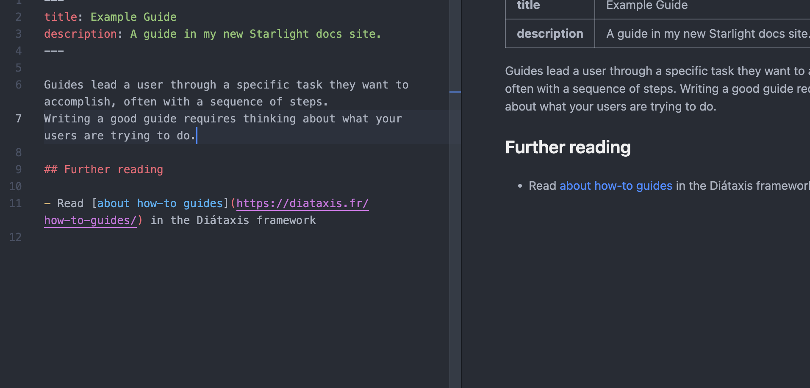

Guides lead a user through a specific task they want to accomplish, often with a sequence of steps.
Writing a good guide requires thinking about what your users are trying to do.

:::tip[Did you know?]
### PENTING!

Jangan lupa baca Al-Quran!
:::

Where and when is the Andromeda constellation most visible?

The [Andromeda constellation](<https://en.wikipedia.org/wiki/Andromeda_(constellation)>) is most visible in the night sky during the month of November at latitudes between `+90°` and `−40°`.

## Further reading

- Read [about how-to guides](https://diataxis.fr/how-to-guides/) in the Diátaxis framework
