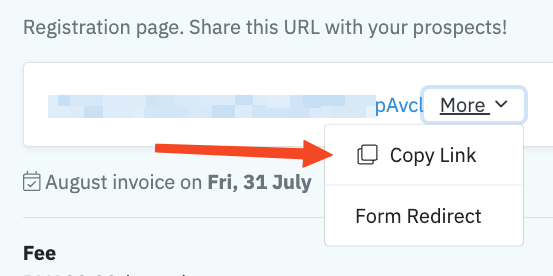

Terdapat 3 cara untuk mendaftarkan pelajar baharu dalam MUDEER:

1. **Borang pendaftaran online** - pelajar daftar sendiri
2. **Pendaftaran manual** - admin daftarkan pelajar
3. **[Import pelajar secara pukal](/panduan/import-data-pelajar)** - muat naik data pelajar dalam bentuk Excel

## Borang Pendaftaran Online

Setiap kelas yang anda buka akan ada link kepada borang pendaftaran dan boleh dikongsikan dengan bakal pelajar untuk mereka mendaftar ke kelas tersebut sendiri.

Anda boleh klik **More → Copy Link** dan share link tersebut dengan pelajar.

Link tersebut akan memaparkan butiran tentang kursus.

Untuk meneruskan pendaftaran, pelajar boleh klik **Register** kemudian masukkan nombor telefon.

Kemudian pelajar perlu mengisi maklumat berikut:

1. Nama
2. Nama ibu bapa
3. Emel
4. Arahan tambahan (jika ada)
5. Alamat (jika perlu)

Setelah mengisi borang, mereka boleh tekan **Register**.

### Caj Yuran Pertama Selepas Pendaftaran

Anda boleh tetapkan supaya invois pertama dikeluarkan secara automatik sebaik sahaja pelajar mendaftar.

Pergi ke kursus berkenaan dan tandakan **Charge on registration**.

Invois untuk bulan semasa akan dikeluarkan sebaik sahaja pelajar melengkapkan pendaftaran.

### Pengesahan Pendaftaran

Setiap pelajar yang mendaftar menggunakan borang pendaftaran online perlu disahkan terlebih dahulu.

Senarai pelajar yang belum disahkan boleh dicapai di **Students → New Students**.

Tandakan nama pelajar dan klik pada butang biru, **Approve** untuk mengesahkan pendaftaran pelajar. Anda boleh juga klik **Approve All** (hijau) untuk mengesahkan kesemua sekali gus.

## Pendaftaran Manual

Sebagai admin, anda sendiri boleh mendaftarkan pelajar ke dalam MUDEER.

### Pelajar Individu

Untuk mendaftarkan pelajar ke kursus individu, anda boleh:

1. Klik pada kursus berkenaan
2. Pergi ke tab **Students** dan 
3. Klik **New Student**

Jika pelajar tersebut pernah mendaftar sebelum ini, anda boleh membuat carian menggunakan nama, nombor telefon, emel atau nombor kad pengenalan di ruangan **Search Customers**.

Klik pada nama pelanggan (atau pelajar) untuk mendaftarkan pelajar ke kursus tersebut.

Anda boleh mengemaskini:

1. Nama pelajar (jika berbeza) di ruangan **Name** dan
2. Yuran bulanan di ruangan **Monthly Fee**.

Fungsi ini boleh digunakan untuk mendaftarkan lebih daripada seorang anak bagi ibu bapa yang sama.

Contohnya, nama ibu yang mendaftarkan anak-anaknya adalah Faridah. Untuk mendaftarkan anak-anaknya yang berbeza, anda boleh membuat carian “Faridah” setiap kali mendaftarkan pelajar dan mengemas kini **Student Name** kepada nama anaknya.

:::tip

Anda boleh gunakan ruangan nama untuk membezakan subjek bagi pelajar yang mengambil pakej yang sama.

Contoh:

- Pakej Super Coaching: Faridah Binti Abdul Latip (Matematik).
- Pakej Super Coaching: Faridah Binti Abdul Latip (Bahasa Inggeris).

:::

Jika pelajar berkenaan memang pelajar baharu, tekan **New Student**.

Masukkan maklumat pelajar:

1. **Student Name** - nama pelajar
2. **IC Number** - nombor kad pengenalan pelajar (jika tiada, boleh masukkan nombor telefon)
3. **Phone** - nombor telefon
4. **Email** (tidak wajib)
5. **Instructions** (tidak wajib) - permintaan customer, contoh: "Guru perempuan sahaja."
6. **Address** (tidak wajib)

Selepas anda berjaya mendaftar pelajar, anda boleh [tetapkan tutor yang akan mengajar](/panduan/penetapan-tutor/).

### Kelas Berkumpulan

Untuk mendaftarkan pelajar ke dalam kelas berkumpulan, pergi ke **Courses**, kemudian klik kelas berkenaan.

Pergi ke tab **Students** dan klik **New Student**.

Proses selanjutnya sama dengan [kelas individu](#pelajar-individu).

Selepas itu, anda akan ditanya sama ada ingin mengeluarkan terus invois pertama. Jika tidak, tekan sahaja **Skip**.

