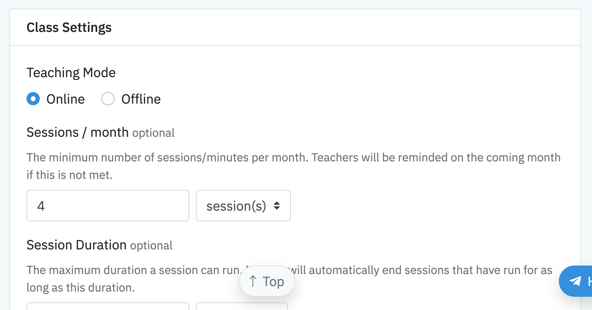

Dalam MUDEER anda perlu mewujudkan **Course** (Kursus) sebelum boleh membuka kelas. Kursus digunakan untuk menyusun kelas-kelas yang anda jalankan.

:::note

Contoh kursus untuk pusat tuisyen:

1. Sekolah Rendah Tahun 1-3
2. Sekolah Rendah Tahun 4-6
3. Sekolah Menengah Tingkatan 1-3
4. Sekolah Menengah Tingkatan 4-5

Contoh kursus untuk kelas mengaji pula:

1. Pakej Asas
2. Pakej Tartil
3. Pakej Tahsin

:::

Terdapat dua jenis kursus dalam MUDEER:

1. **Individu** - seorang guru mengajar seorang pelajar seperti personal coaching dan kelas mengaji *one-to-one*.
2. **Berkumplan** - seorang guru mengajar ramai pelajar.

## Kursus Individu

Untuk membuka kursus individu, tekan menu **Courses**, kemudian klik **NEW → Individual** di bahagian atas kanan.

Masukkan nama kursus.

Di bahagian **Fee Settings**, masukkan yuran untuk kursus tersebut. Jika yuran adalah secara bulanan, tandakan **Every month**.

:::note

Ini adalah yuran umum kursus. Boleh ada pelajar yang membayar yuran berbeza. Anda boleh tetapkan yuran bagi setiap pelajar yang mendaftar kursus tersebut.

Nanti saya tunjukkan.

TODO: Write about setting fees for each enrollment.

:::

Kemudian masukkan hari bulan yang anda ingin invois dikeluarkan dan juga untuk bulan mana. Setiap bulan, sistem akan menjana invois dan hantarkannya kepada pelajar (atau _parents_) mengikut tetapan anda.

:::tip[Contoh Tetapan]

Contoh tetapan yang anda boleh buat:

1. Anda ingin mengeluarkan invois siap-siap setiap 25 hari bulan untuk bulan akan datang - pilih 25 dan di bahagian bulan, pilih **next**. Contoh: invois bulan Mei akan keluar pada 25 hari bulan April.
2. Anda ingin mengeluarkan invois pada awal bulan, 1 hari bulan - pilih 1 dan pastikan bahagian bulan ditetapkan **current**. Contoh: invois Januari akan keluar pada 1 Januari.
3. Anda benarkan pelajar untuk belajar dahulu kemudian bayar yuran pada 1 hari bulan depan - pilih 1 dan di bahagian bulan pilih **previous**. Contoh: invois bulan Mei akan keluar pada 1 Jun.

:::

## Yuran Sekali Sahaja

Untuk yuran kursus **"sekali sahaja"**, seperti seminar atau bengkel, pastikan **Every month** tidak ditandakan.

Invois tidak akan dijana secara automatik setiap bulan.

## Yuran Belajar Dulu Baru Bayar

MUDEER membenarkan anda mengenakan yuran secara **"belajar dulu, baru bayar"**.

Contohnya, jika yuran pelajar adalah RM25 untuk setiap sesi kelas, anda boleh tandakan **Prorate**, kemudian masukkan nilai 25 dan pilih **per session**.

Katalah pada bulan lepas Januari, tutor telah merekodkan 3 sesi kelas. Pada 1 hari bulan Februari (bulan berikutnya), sistem akan mengeluarkan invois dengan caj RM75 kerana hanya 3 sesi direkodkan pada bulan lepas.

:::caution

Isu yang kerap berlaku bagi _prorate_ adalah tutor tidak merekodkan kelas sebelum invois dikeluarkan yang menyebabkan kiraan yuran tidak betul.

Pastikan tutor merekodkan sesi sebelum invois dikeluarkan.

:::

## Caj Yuran Selesai Pendaftaran

Untuk mengeluarkan invois pertama sebaik sahaja pelajar mendaftar melalui borang pendaftaran online, tandakan **Charge on registration**. Pelajar akan dibawa kepada paparan invois sebaik sahaja selesai pendaftaran.

## Tetapan Kelas

Di bahagian **Class Settings**, anda boleh tetapkan:

1. **Teaching Mode** - sama ada _online_ atau _offline_.
2. **Session / month** - jumlah sesi atau tempoh minima yang tutor perlu buat setiap bulan.
3. **Session Duration** - tempoh biasa satu sesi.

Ruangan **Session Duration** adalah untuk membantu tutor mengenal pasti tempoh bagi setiap sesi kelas yang perlu mereka jalankan.

:::note

Tempoh **Session Duration** pada kursus sekadar panduan untuk tutor, sistem tidak menghalang mereka untuk merekodkan sesi lebih daripada yang ditetapkan di sini.

:::

Masukkan keterangan tentang kursus tersebut di ruangan **Description**. Ruangan ini tidak wajib dan boleh dibiarkan kosong.

**Customer Instructions Template** pula adalah untuk anda mendapatkan maklumat tambahan daripada pelajar.

*Template* yang anda masukkan akan terpapar dalam borang pendaftaran online.

*Borang pendaftaran online.*

Untuk menyelaraskan format laporan tutor, anda boleh tetapkan format tersebut dalam ruangan **Session Notes Template**.

Ruangan **Notes** akan diisi dengan template ini setiap kali tutor memulakan sesi kelas.

## Menghadkan Sesi Tutor Setiap Bulan

Anda boleh menghadkan jumlah sesi atau tempoh masa yang tutor boleh rekodkan dalam sebulan supaya tidak melebihi bilangan atau tempoh yang telah ditetapkan.

Pergi ke **Settings** (atas-kanan).

Di bahagian **Classes**, tandakan **Limit Monthly Sessions**. MUDEER akan menghalang tutor daripada memulakan sesi baru jika jumlah atau tempoh sesi yang ditetapkan pada **Class Settings** telah tercapai.

## Kursus Berkumpulan

Sebelum anda boleh membuka kelas berkumpulan, anda perlu mewujudkan kursus berkumpulan.

Pergi ke **Courses** dan klik **NEW → Group**.

Tetapan untuk kursus berkumpulan sama seperti kursus individu. Anda boleh rujuk panduan [kursus individu](#kursus-individu).

## Buka Kelas Berkumpulan

Selesai mewujudkan kursus berkumpulan, anda boleh membuka kelas. Anda boleh tetapkan tutor yang mengajar dan daftarkan pelajar ke dalam kelas tersebut.

Di paparan kursus berkenaan, pergi ke tab **Groups** dan klik **NEW GROUP**.

Masukkan nama kelas di ruangan **Name**. Secara lalai nama kelas akan diambil daripada nama kursus diikuti nama bulan depan (contoh: Jun 2026).

Di ruangan **Teacher** anda boleh tetapkan tutor yang akan mengajar kelas ini.

Anda boleh tetapkan kadar elaun tutor di ruangan **Allowance Rate**. MUDEER akan membantu anda kira elaun tutor setiap bulan. Tutor hanya perlu [merekodkan setiap sesi](/panduan/panduan-tutor) yang mereka jalankan.

Elaun bulanan tutor boleh ditetapkan mengikut:

1. **Jam (per hour)** - jumlah jam bagi semua sesi yang dijalankan
2. **Sesi (per session)** - bilangan sesi yang dijalankan
3. **Bulanan (monthly)** - amaun tetap, tak kira berapa jumlah jam atau sesi dijalankan.

Contohnya, jika anda bayar tutor RM20 sejam, anda boleh masukkan 20 dan pilih **per hour**. MUDEER akan mengira elaun tutor setiap bulan berdasarkan sesi yang tutor rekodkan dalam sistem.

### Link ke Group WhatsApp / Telegram

Jika anda wujudkan Telegram atau WhatsApp group untuk setiap kelas, anda boleh masukkan link ke group di ruangan **WhatsApp / Telegram Group Link**. Maklumat ini akan memudahkan anda mencapai group tersebut.

### Tangguh Yuran Automatik

Untuk penjanaan invois yuran kelas automatik, anda boleh tandakan **Hold Billing**.

Anda boleh juga tetapkan sehingga bila anda ingin penjanaan yuran ditangguhkan. Penjanaan invois automatik untuk kelas tersebut akan kembali aktif selepas tarikh yang anda tetapkan itu. 

## Penetapan Jadual Kelas

Jadual mingguan kelas boleh dimasukkan di bahagian **Schedules**.

Contohnya, jika kelas tersebut dijalankan setiap hari Selasa pukul 7-8 malam, anda boleh klik **Add** pada Tuesday dan masukkan 7 PM sebagai masa mula dan 8 PM sebagai masa tamat.

